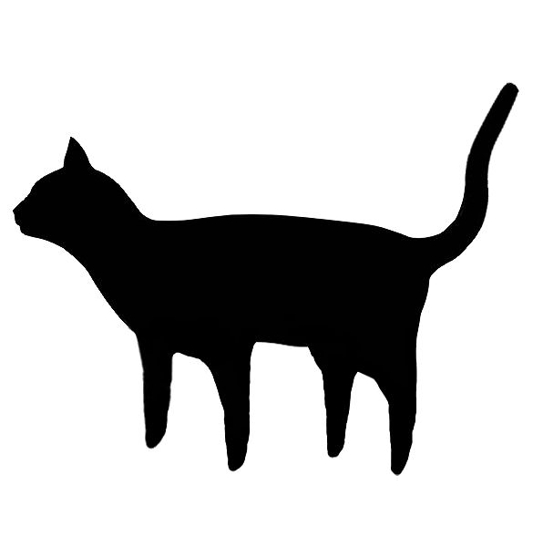
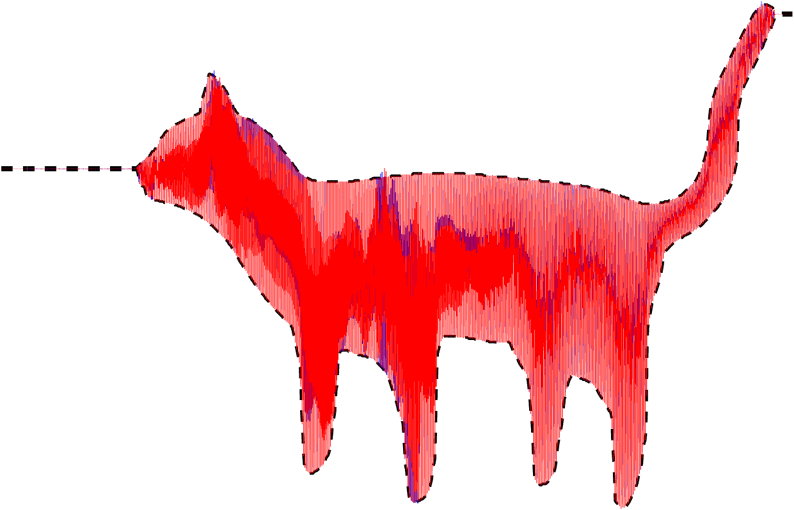
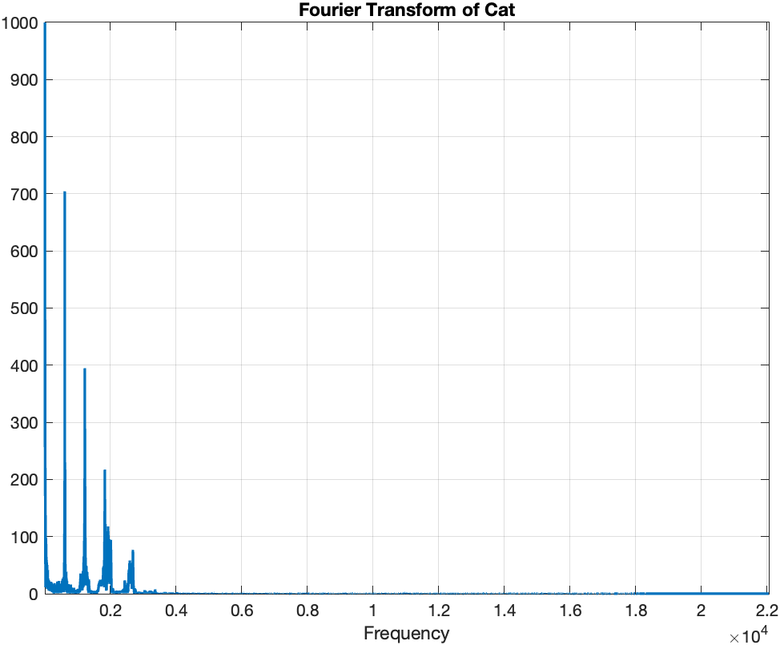

<h1 align="center">Image-Shaped Audio</h1>

<p align="center"><b>A cat's meow, squeezed until its waveform <i>is</i> a cat.</b></p>

<p align="center">
  <picture>
    <source media="(prefers-color-scheme: dark)" srcset="examples/cat/output/cat_signal_cropped_dark.svg">
    
  </picture>
</p>

<p align="center">
  🔊 <a href="examples/cat/output/cat-shape-meow.wav"><b>Listen to the cat-shaped meow</b></a>
  &nbsp;·&nbsp;
  <a href="examples/cat/input/cat-meow.mp3">the original meow</a>
  &nbsp;·&nbsp;
  🔍 <a href="examples/cat/output/cat_signal_cropped.png">zoom in (4830 px)</a>
</p>

---

## What am I looking at?

That's not a drawing. It's about 0.86 seconds of real, playable stereo audio (44.1 kHz) plotted sample by sample: blue is the left channel, red is the right. Every sample was rescaled so the waveform's peaks land on the outline of a cat silhouette. The dashed line is the outline it was poured into.

Play the `.wav` and decide for yourself whether it still sounds like a cat.

## How it works

<table>
  <tr>
    <th>Shape</th>
    <th>Sound</th>
    <th>Result</th>
  </tr>
  <tr>
    <td align="center"></td>
    <td align="center"><a href="examples/cat/input/cat-meow.mp3"><code>cat-meow.mp3</code></a></td>
    <td align="center"></td>
  </tr>
</table>

1. **Trace.** Threshold the image (Otsu), fill holes, and keep the largest outline.
2. **Profile.** For each pixel column, record the outline's top and bottom edges. The image becomes two curves.
3. **Stretch.** Resample both curves to the length of the meow, so each image column covers a few dozen audio samples.
4. **Flatten.** Divide the meow by its own peak envelope so it bounces evenly between −½ and +½, no matter how loud it was.
5. **Pour.** Scale it by the outline's height and shift it onto the outline's midline:

```
shaped(t) = midline(t) + height(t) · (audio(t) − center(t)) / span(t)
```

The quiet bits before and after the meow ride along as the flat lines leading into the nose and out of the tail.

The silhouette ([`cat_silhouette.jpg`](examples/cat/input/cat_silhouette.jpg)) is redrawn by hand, with straight legs and no shadow or whiskers. The method only sees each column's top and bottom edge, so a shape with clean vertical edges traces best.

## Bonus: the Fourier transform of a cat

<p align="center">
  
</p>

## Make your own

There's a MATLAB version and a Python version. They follow the same steps, take the same options, and make the same cat.

### MATLAB

You need the **Image Processing** and **Signal Processing** toolboxes.

From the repo folder, rebuild the cat (writes the `.wav` and figures to `examples/cat/output`, then plots the spectrum):

```matlab
run matlab/catwaveform.m
```

Use any shape and any sound:

```matlab
addpath matlab
result = imageShapedAudio("my_shape.png", "my_sound.wav", OutputFile="shaped.wav");
plotShapedAudio(result, ExportFile="shaped.svg");
```

### Python

No MATLAB needed:

```bash
pip install -r python/requirements.txt
```

Rebuild the cat (writes to `examples/cat/output`):

```bash
python python/cat_waveform.py
```

Use any shape and any sound from the command line:

```bash
python python/image_shaped_audio.py my_shape.png my_sound.wav --wav shaped.wav --plot shaped.svg
```

Or from Python:

```python
import sys; sys.path.append("python")  # from the repo folder
from image_shaped_audio import shape_audio, plot_shaped_audio

result = shape_audio("my_shape.png", "my_sound.wav")
result.write("shaped.wav")
plot_shaped_audio(result, "shaped.svg")
```

### Options

| MATLAB | Python | Default | What it does |
| --- | --- | --- | --- |
| `Segment` | `segment`, `--segment` | `"auto"` | Which samples get shaped: a start and end sample, `"auto"` (trim leading and trailing silence), or `"all"` |
| `SilenceThreshold` | `silence_threshold` | `0.05` | For `"auto"`: how loud (fraction of the peak) counts as sound |
| `EnvelopeWindow` | `envelope_window` | `50` | Peak-envelope window in samples. Bigger is smoother but hugs the outline less tightly |
| `ShapeColor` | `shape_color` | `"auto"` | `"dark"` or `"light"`: which pixels are the shape. `"auto"` picks whichever covers less of the image |
| `Peak` | `peak` | `0.9` | Loudest point of the outline in the output file (0 to 1) |
| `OutputFile` | `result.write(...)`, `--wav` | | Where to write the shaped audio |
| `Title`, `Artist` | `title=`, `artist=` | | Metadata for the output file |

Command-line flags use dashes: `--silence-threshold`, `--envelope-window`, and so on.

> [!NOTE]
> Sample numbers follow each language's own counting. MATLAB's `Segment=[6500 37200]` (1-based, inclusive) is `segment=(6499, 37200)` in Python (0-based, end excluded, like a slice).

The plotting functions take an export file (`.svg`, `.pdf` and `.eps` come out as vectors with a transparent background; `.png` and `.jpg` as images), colors for each channel, and an outline color. Use a light outline such as `#e6edf3` for dark backgrounds.

To keep the inside of the shape from blurring into solid color, the plots draw every sample with thin lines on a large canvas. Image exports are about 5000 px wide, enough to see individual oscillations when you zoom in. The figure also takes the silhouette's proportions, so the shape isn't stretched.

| MATLAB | Python | Default | What it does |
| --- | --- | --- | --- |
| `Crop` | `crop`, `--crop` | off | Draw just the shape, without the lead-in and lead-out lines |
| `Resolution` | `dpi` | `600` / `300` | Image export resolution (the canvases differ in size, so both come out about 5000 px wide) |
| `Width` | `width` | 1000 px / 16 in | Canvas width |
| `LineWidth`, `OutlineWidth` | `line_width`, `outline_width` | thin / bold | Waveform and outline thickness in points |

**Tips for shapes.** Use one solid object on a plain background. PNGs with transparency work: the alpha channel becomes the shape. Overhangs (like the gap under a chin) get filled in, because each column keeps only its highest and lowest edge.

## What's where

```
matlab/
  imageShapedAudio.m      shapes any sound into any silhouette
  plotShapedAudio.m       plots the result and exports it
  catwaveform.m           the cat, start to finish
  experiments/            the first scripts, kept for history
python/
  image_shaped_audio.py   the same in Python, plus a command-line tool
  cat_waveform.py         the cat, in Python
  requirements.txt
examples/cat/
  input/                  cat_silhouette.jpg, cat-meow.mp3
  output/                 cat-shape-meow.wav, the figures, FTcat.png
```

In `examples/cat/output`, `cat_signal_cropped` is just the cat (the picture at the top, plus a 4830 px PNG for zooming), and `cat_signal` is the full plot with the lead-in and lead-out lines. Files ending in `_dark` have a light outline for dark backgrounds.

## License

The code is [MIT licensed](LICENSE). The meow sample comes from a free-to-use sound source and keeps that source's terms.
